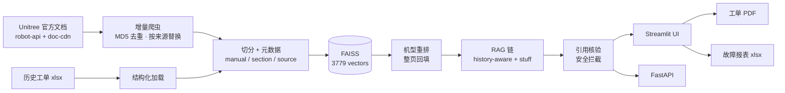

# 宇树机器人售后 AI 助手

> 面向 Unitree（宇树）机器人售后场景的 RAG 知识库助手：把官方文档和历史工单，变成**可检索、可追溯、可培训**的答案。

**技术栈**：Python 3.12 · LangChain 1.4.7（链式构造器由 `langchain-classic` 提供）· FAISS · Streamlit · FastAPI · fpdf2

> 版本选择：LangChain 0.3 已进入维护期（2026 年 12 月停止支持），本项目跟随 **1.x LTS**；
> 若需停留在 0.3，可用 `requirements-langchain-0.3.txt`，代码同时兼容两条线。

[](https://www.python.org/)
[](https://docs.langchain.com/oss/python/releases/langchain-v1)
[](https://streamlit.io/)
[](https://fastapi.tiangolo.com/)
[](#license)

---

## 这个项目解决什么问题

售后技术支持每天面对的是同一类困境：

- 手册有 **27 本、500 多页**，工程师记不住，新人更查不到；
- 宇树机型多（H1 / H1-2 / G1 / Go2 / B2 / A2 / H2 / R1…），**接口、故障码、关节顺序各不通用**，套错机型就是事故；
- 通用大模型答得流畅，但会**编造扭矩、配件号、故障码**，在售后场景里比答不上来更危险；
- 同样的故障反复被问，经验留在个人微信里，**沉淀不成知识库**。

这个项目把「官方文档 + 历史工单」做成一套可落地的售后助手：按机型检索、强制标注出处、涉及安全先拦截、答不出来就承认，并能一键生成维修工单。

## 核心特性

| 能力 | 说明 |
|---|---|
| 📚 官方文档全量入库 | 27 本手册、542 页、3.7k 分块，覆盖人形 / 四足 / 机械臂 / 组件 / 感知 / SLAM |
| 🔍 对话式 RAG | LCEL 链路，支持多轮追问；单轮自动跳过问题改写，响应更快 |
| ⚡ 流式输出 | 检索完成即出答案首字，逐 token 渲染；无 Key / 失败时自动降级为非流式 |
| 📌 强制出处 | 每条事实标注「手册名 › 章节名」或「工单号」，可点回原文 |
| 🛡️ 引用核验 | 答案里的工单号 / 配件号 / 扭矩值若不在检索结果中，自动追加告警 |
| ⚠️ 安全前置 | 冒烟、电池鼓包、过热、跌倒、卡死等关键词命中时，先给处置建议 |
| 🎯 机型感知 | 识别 H1 / H1-2 / G1 / Go2 等，跨型号内容不混用；缺机型时主动追问 |
| 📄 工单 PDF | fpdf2 生成 A4 中文工单，自动查找系统字体 |
| 🌐 中英双语 | 界面与回答双语切换；回答可一键生成「一段中文、一段英文」对照 |
| 📊 故障报告 | 故障类型 / 型号 / 月度趋势 / 配件 TOP，导出多 Sheet Excel |
| 🧯 降级运行 | 没配 Key 也能跑：离线哈希向量 + 仅检索模式，返回原文与出处 |

## 架构



## 快速开始

```bash
git clone <your-repo-url> robot-support-ai
cd robot-support-ai

python -m venv .venv
# Windows
.\.venv\Scripts\Activate.ps1
# macOS / Linux
source .venv/bin/activate

pip install -r requirements.txt
cp .env.example .env      # 填入 API Key
```

`.env` 最少需要两组 Key：

```ini
# 生成（DeepSeek / 通义千问 / OpenAI 任选其一）
LLM_PROVIDER=deepseek
LLM_MODEL=deepseek-flash
DEEPSEEK_API_KEY=sk-xxx

# 向量化（DeepSeek 没有 embedding 接口，这里用 DashScope）
DASHSCOPE_API_KEY=sk-xxx
```

初始化数据与索引：

```bash
python scripts/init_mock_data.py     # 50 条演示工单（可跳过）
python scripts/sync_docs.py          # 同步 27 本官方手册（约 10 分钟）
```

同步完成后如果只想重建向量（不重新抓取），用本地缓存即可，不需要联网：

```bash
python scripts/build_index.py --from-cache   # 用 data/docs_cache + hash_records 重建
```

> 部分网络出口会拦截 `dashscope.aliyuncs.com` 的普通 TLS 握手（直接 EOF），
> 项目内置的 `DashScopeCurlEmbeddings` 会用浏览器指纹（`curl_cffi`）调用，
> 同一出口即可正常返回 1536 维向量。

启动：

```bash
streamlit run app.py                 # http://localhost:8501
uvicorn api_server:app --port 8000   # http://127.0.0.1:8000/docs
```

Docker：

```bash
docker build -t unitree-support-ai .
docker run -p 8501:8501 --env-file .env unitree-support-ai
```

## 数据是怎么来的

| 来源 | 方式 | 规模 |
|---|---|---|
| 文档中心 | `robot-api.unitree.com` 目录接口展开 + `doc-cdn.unitree.com` 拉 Markdown 正文 | 27 本 / 542 页 / 473 页有效 |
| 历史工单 | Excel 结构化读取（工单号、机型、现象、诊断、方案、配件） | 50 条演示数据 |

同步策略是**按页 MD5 比对、按来源整体替换**：页面更新时先删旧分块再写新分块，避免旧手册内容残留；失败逐页记录，不中断整批。原文会缓存到 `data/docs_cache/`，便于离线核对与重建。

## RAG 设计取舍

| 决定 | 原因 |
|---|---|
| `create_history_aware_retriever` + `create_stuff_documents_chain` + `create_retrieval_chain` | 等价的 LCEL 组合，替代已弃用的 `ConversationalRetrievalChain`；LangChain 1.x 中这些构造器由 `langchain-classic` 提供 |
| 单轮跳过问题改写 | 没有上下文时不必多调一次模型，实测省约 40% 时延 |
| 召回 8 倍再重排 | 「机型 + 章节」类问题，正确页面常在 20 名开外 |
| 章节名写入被向量化的正文 | 很多页面是纯表格（如「H1-2关节电机顺序」），标题里才有机型 |
| 命中后整页回填 | 表格被切碎时，单块只剩表头；按 source 拼回整页 |
| 同义词扩展 | 手册里「故障码 / 错误码 / 错误代码」混用；英文提问补中文术语 |
| 引用核验 | 确定性校验，专治模型编造配件号与扭矩 |
| 安全规则在代码层 | 不依赖模型是否听话；命中关键词一定先出安全段 |

## 效果示例

```text
Q: H1-2 的关节电机顺序是什么？
A: 命中《H1 SDK 开发指南 › 软件服务接口 › H1-2关节电机顺序》，
   复述 Index 0–26 与 Servo Mode，并指出可用「按关节名排序」表交叉验证。
   耗时 6.3s，引用 4 条。

Q: G1 报错了，怎么查故障码含义？
A: 命中《G1 SDK 开发指南 › 常见错误及释义》，
   区分「设备总状态信息」与「电机状态信息」两张位定义表。
   耗时 7.7s。

Q: Go2 电池鼓包还能继续用吗？
A: 顶部安全提示（停止充电、隔离、按危险品回收），结论引自工单，
   并区分「手册有据」与「经验推断」。
```

## 项目结构

```text
robot-support-ai/
├── app.py                  # Streamlit 前端（诊断 / 同步 / 报告 / 设置）
├── api_server.py           # FastAPI（/api/ask /sync /work-order /report）
├── src/
│   ├── config.py           # 配置单例、服务商预设、自检
│   ├── data_loader.py      # PDF / Excel 加载与切分
│   ├── crawler_sync.py     # 官网增量同步（含反爬兜底）
│   ├── vector_store.py     # FAISS 单例、去重、持久化
│   ├── rag_chain.py        # LCEL 问答链、重排、安全与引用核验
│   ├── translate.py        # 中英对照翻译
│   ├── i18n.py             # 界面双语词表
│   ├── work_order.py       # 工单 PDF
│   └── report.py           # 故障统计与 Excel 导出
├── scripts/                # 同步 / 建索引 / 生成演示数据
├── data/                   # urls.json、工单、文档缓存、字体
├── vectorstore/            # FAISS 索引（建议不入库）
├── Dockerfile
└── requirements.txt
```

## 配置项

| 变量 | 默认 | 作用 |
|---|---|---|
| `LLM_PROVIDER` | `auto` | `auto` / `dashscope` / `deepseek` / `openai` |
| `LLM_MODEL` | 按服务商 | 如 `deepseek-flash`、`qwen-plus` |
| `LLM_MAX_TOKENS` | 3000 | 推理型模型会先输出思考过程，需留足 |
| `EMBEDDING_PROVIDER` | `auto` | `dashscope` / `openai` / `local`（BGE，需 fastembed）/ `hash`（离线兜底） |
| `CHUNK_SIZE` / `CHUNK_OVERLAP` | 600 / 80 | 切分参数 |
| `RETRIEVER_K` | 4 | 送入 Prompt 的片段数 |
| `CRAWL_DELAY` | 2.0 | 抓取间隔（秒） |
| `PDF_FONT_PATH` | 空 | 指定中文字体路径 |

## API 示例

```bash
curl -X POST http://127.0.0.1:8000/api/ask \
  -H "Content-Type: application/json" \
  -d '{"question":"H1 右膝异响怎么排查","history":[],"language":"zh"}'
```

```bash
curl -X POST http://127.0.0.1:8000/api/work-order \
  -H "Content-Type: application/json" \
  -d '{"order_id":"WO-001","model":"H1","symptom":"右膝异响","diagnosis":"法兰螺栓松动","solution":"按扭矩规范紧固"}' \
  -o work_order.pdf
```

## 验证结果（本机实测）

| 项目 | 结果 |
|---|---|
| 官方文档同步 | 542 页检查、473 页入库、0 失败 |
| 向量库 | 3779 条（3729 文档 + 50 工单），1536 维，22 MB |
| 问答 | H1-2 关节顺序 / G1 故障码 / Go2 电池鼓包 均命中正确章节，8–15 秒 |
| 引用核验 | 伪造工单号与扭矩值会被追加告警，真实答案不误报 |
| 工单 PDF | 中文 A4 单页，可提取文本 |
| API | `/health` `/api/ask` `/api/report` `/api/report/export` 全 200 |
| 前端 | 四个页面、回车发送、中英切换均通过（AppTest） |
| 流式输出 | 778 个增量片段，首字 5.3s（含检索），整篇 9.0s |

## 已知限制

- **不是官方产品**：个人项目，与宇树科技无隶属关系。
- 官网接口有腾讯 EdgeOne 人机校验，部分出口会返回 **HTTP 567**；程序会用浏览器 TLS 指纹重试，仍失败则记录并继续。
- 部分网络对 `dashscope.aliyuncs.com` 的普通 TLS 握手直接断开；项目改用 `curl_cffi` 浏览器指纹调用，必要时请确认该出口可访问 DashScope。
- 知识库覆盖官方文档与模拟工单；**真实售后数据未接入**，工单经验部分请自行替换。
- 文档中的图片、接线图、公式**未做 OCR**，涉及图示的排查会缺细节。
- 未做鉴权与多租户，**不适合直接暴露到公网**。

## 路线图

- [x] 流式输出（首字更快）
- [ ] 引入 rerank 模型，替代规则重排
- [ ] 评测集与回归测试（问题 → 期望章节）
- [ ] 真实工单接入与脱敏流水线
- [ ] docker-compose 一键起（含向量库初始化）

## License

代码采用 MIT 协议。文档内容版权归宇树科技所有，本仓库仅存储公开文档的检索索引与缓存，用于技术学习与内部支持演示，请勿用于商业分发。

---

如果这个项目对你有帮助，欢迎 Star ⭐；有售后场景的需求或建议，也欢迎开 Issue。
